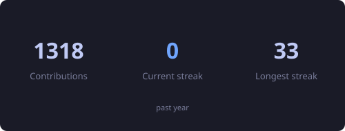
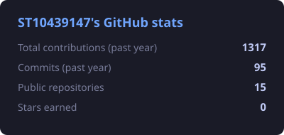
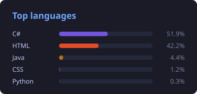
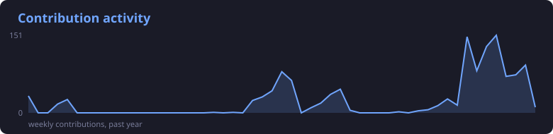

<div align="center">


<p>
  <a href="https://www.linkedin.com/in/dillon-rinkwest-1005702a0"></a>
  <a href="mailto:dillonrinkwest@outlook.com"></a>
  <a href="https://github.com/ST10439147?tab=repositories"></a>
  
</p>

</div>

---

## 🧩 What I build

Final-year BCAD student (Application Development) at **Emeris, Newlands**, Cape Town. I build **C# / ASP.NET Core** backends and wire them to **Azure**: serverless functions, table/blob/queue storage and SQL. I also tutor for the School of Computer Science.

```yaml
focus:      backend & cloud engineering
backend:    ASP.NET Core MVC / Web API · EF Core · ADO.NET · xUnit
frontend:   Blazor · .NET MAUI · WPF · Bootstrap 5
cloud:      Azure Functions · Azure SQL · Table / Blob / Queue Storage · Key Vault · Web Apps · Firebase
languages:  C# · Kotlin · Java · SQL · NoSQL · JavaScript
available:  backend & cloud roles from November 2026
```

<div align="center">
  
<br />
  
  
  
  
</div>

---

## 🎓 Academics

**85.75% cumulative average** (≈ 3.9/4.0 GPA), with distinctions in 19 of 20 modules completed.

 Member of the **Golden Key International Honour Society** (since 12 May 2026), an invitation-only society recognising the top 15% of students.

---

## 🚀 Featured projects

<table>
<tr>
<td width="50%" valign="top">

### ☁️ [Azure Retail Platform](https://github.com/ST10439147/Cloud-Azure-Functions-App)
Retail management on **ASP.NET Core 8 MVC** with cookie auth and role-based access. Azure SQL for credentials, Table / Blob / Queue Storage for business data, CRUD exposed through **Azure Functions** (.NET 8 isolated).

`ASP.NET Core` `Azure Functions` `Azure Storage` `Azure SQL`

</td>
<td width="50%" valign="top">

### 📑 [Contract Monthly Claim System](https://github.com/ST10439147/CMCS_Platform)
Two-stage approval workflow (Coordinator → Manager) across four user roles, with **AES-256 encrypted** document storage and a full audit trail.

`ASP.NET Core` `EF Core` `SQL Server` `xUnit`

</td>
</tr>
<tr>
<td width="50%" valign="top">

### 🤝 NPO Management Platform *(WIL, private)*
Building with a student team for Quloobul Moe'mieneen, a non-profit: **ASP.NET Core Web API on .NET 10**, Blazor web client and a .NET MAUI Android client.

`.NET 10` `Blazor` `MAUI` `Azure SQL` `Key Vault`

</td>
<td width="50%" valign="top">

### 🛡️ [Cybersecurity Awareness Chatbot](https://github.com/ST10439147/Chatbot)
WPF assistant with sentiment detection, a scored quiz module, and user state (name, preferences, history) persisted across sessions.

`C#` `WPF`

</td>
</tr>
</table>

> ☕ **Java:** [StudentManagerSystem](https://github.com/ST10439147/StudentManagerSystem) · [KanbanBoard](https://github.com/ST10439147/KanbanBoard) · [FPSJFrame](https://github.com/ST10439147/FPSJFrame) (Swing maze game)

---

## 💼 Experience

**Tutor**, School of Computer Science, Emeris (Newlands): supporting students in application development and programming fundamentals.

---

## 📊 By the numbers

<div align="center">








<picture>
  <source media="(prefers-color-scheme: dark)" srcset="https://raw.githubusercontent.com/ST10439147/ST10439147/output/snake-dark.svg" />
  
</picture>

<sub>Stat cards are generated from the GitHub GraphQL API by <a href="./scripts/generate_stats.py">a script in this repo</a> and committed every 6 hours.</sub>

</div>

### ⏱️ This week I coded

<!--START_SECTION:waka-->

```txt
From: 11 October 2026 - To: 18 October 2026

Markdown          4 hrs 39 mins         █████████▒░░░░░░░░░░░░░░░   36.91 %
C#                3 hrs 40 mins         ███████▒░░░░░░░░░░░░░░░░░   29.12 %
Text              1 hr 7 mins           ██▒░░░░░░░░░░░░░░░░░░░░░░   08.89 %
Razor             52 mins               █▓░░░░░░░░░░░░░░░░░░░░░░░   06.94 %
YAML              33 mins               █░░░░░░░░░░░░░░░░░░░░░░░░   04.37 %
```

<!--END_SECTION:waka-->
